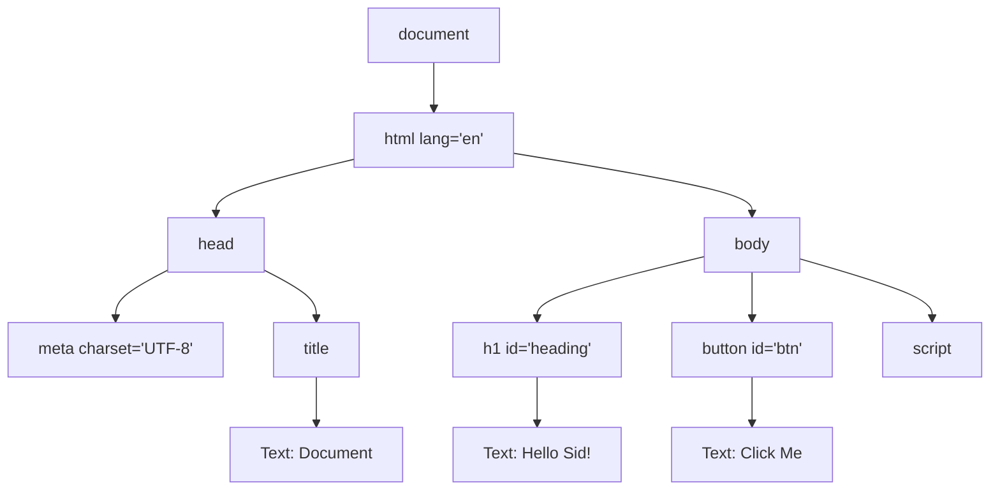

# 🌳 DOM (Document Object Model)

## 📌 What is DOM?
The **DOM** is a tree-like representation of an HTML document that allows JavaScript to access and modify HTML elements, content, styles, and events.

## ⚙️ How DOM Works

```text
HTML File
   ↓
Browser parses HTML
   ↓
DOM Tree 🌳
   ↓
JavaScript accesses/modifies DOM
   ↓
Browser updates the UI
```

## 🧩 Example

**HTML:**
```html
<!doctype html>
<html lang="en">
  <head>
    <meta charset="UTF-8" />
    <title>Document</title>
  </head>
  <body>
    <h1 id="heading">Hello Sid!</h1>
    <button id="btn">Click Me</button>
    <script>
      const heading = document.getElementById("heading");
      const button = document.getElementById("btn");

      button.addEventListener("click", () => {
        heading.textContent = "Hello JavaScript!";
        heading.style.color = "blue";
      });
    </script>
  </body>
</html>
```

## DOM Tree


### 🔍 How It Works
1. 🌐 Browser parses HTML and creates the DOM tree.
2. 🎯 `getElementById()` selects the heading and button.
3. 🖱️ `addEventListener()` listens for a click.
4. ✏️ `textContent` changes the heading text.
5. 🎨 `style.color` changes its color.
6. 🔄 Browser displays the updated UI.

## 🛠️ Common DOM Methods

| Method / Property | Purpose |
|---|---|
| `getElementById()` | Select by ID |
| `querySelector()` | Select the first CSS selector match |
| `querySelectorAll()` | Select all CSS selector matches |
| `textContent` | Read or change text |
| `innerHTML` | Read or change HTML markup |
| `style` | Change inline CSS |
| `classList` | Add/remove CSS classes |
| `createElement()` | Create an element |
| `appendChild()` | Add a child node |
| `addEventListener()` | Handle events like clicks |
| `remove()` | Remove an element |

## 🆚 HTML vs DOM vs JavaScript

- 🏗️ **HTML:** Defines the page structure.
- 🌳 **DOM:** Represents the page as objects.
- 🧠 **JavaScript:** Interacts with the DOM to make the page dynamic.
- 🎨 **CSS:** Controls appearance and layout.

> 💡 **Remember:** HTML defines the structure → the browser creates the DOM → JavaScript manipulates the DOM → the browser updates the UI.