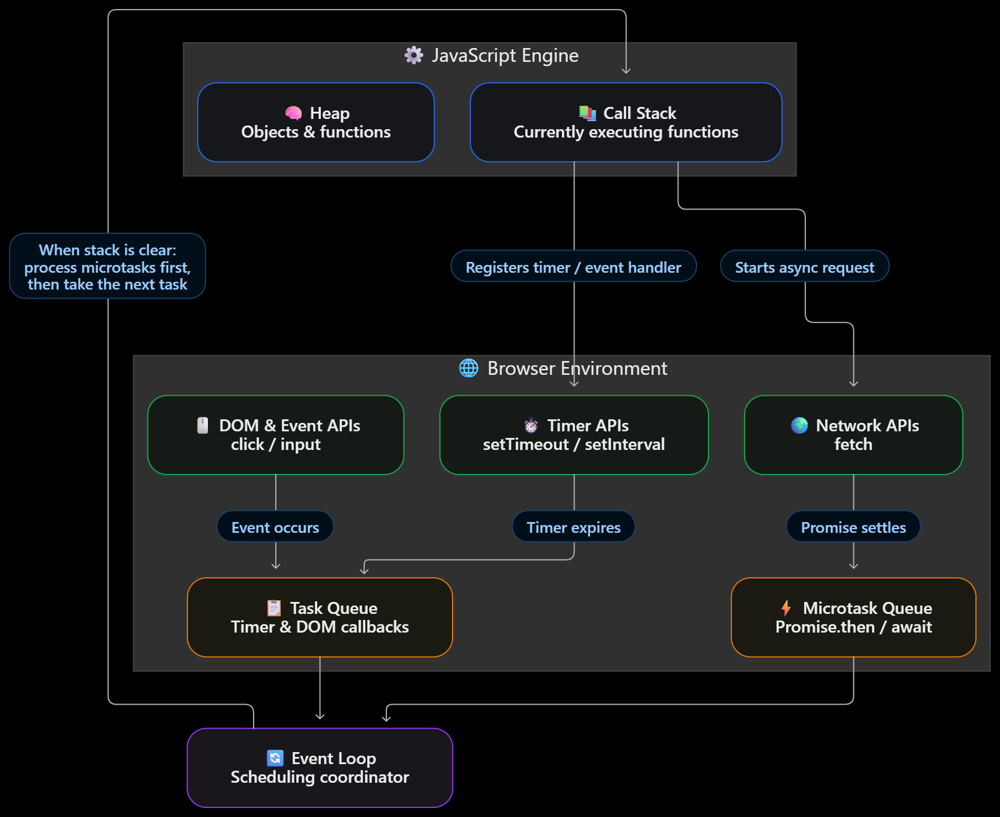
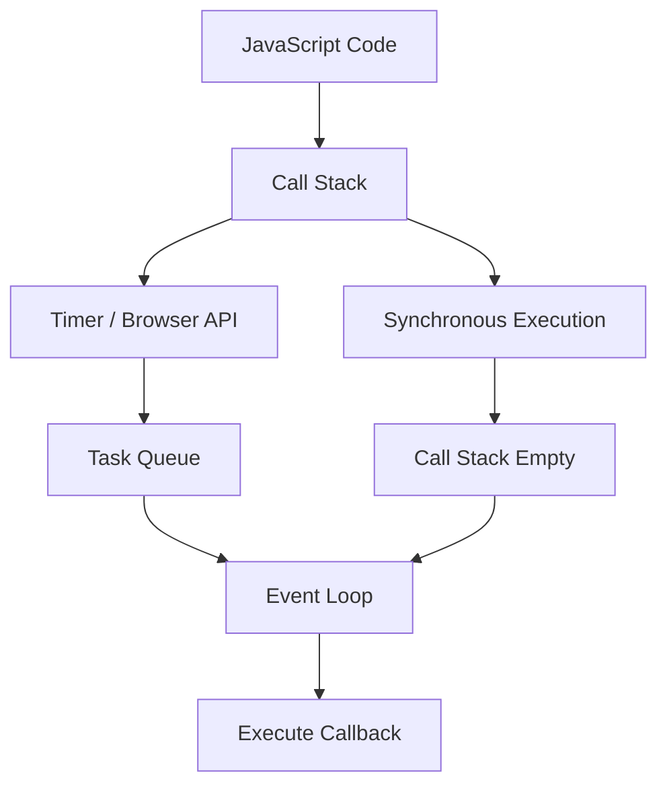

# ⏳ JavaScript Asynchronous Programming

> Note: Async not means the multi threaded it just that the block of code scheduled to some future time and don't affect the current execution

## Internals of Async and JS



## 1. 🔄 Synchronous vs Asynchronous

- **Synchronous:** Executes line by line; each statement waits for the previous one to finish.
- **Asynchronous:** Allows JavaScript to continue executing while waiting for operations like timers or API calls.

```javascript
console.log("A");

setTimeout(() => console.log("B"), 1000);

console.log("C");

// Output: A → C → B
```

## 2. 📞 Callback Functions

A **callback** is a function passed as an argument to another function, which can invoke it when needed.

```javascript
function greet(name, callback) {
    console.log(`Hello ${name}`);
    callback();
}

greet("Sid", () => console.log("Welcome!"));

// Output:
// Hello Sid
// Welcome!
```

- ✅ Callbacks can be synchronous or asynchronous.
- ⚠️ A callback is not automatically asynchronous; it depends on how it is executed.

## 3. ⚙️ Call Stack, Browser APIs & Event Loop

| Component | Responsibility |
|---|---|
| 📚 Call Stack | Executes JavaScript functions |
| 🌐 Browser APIs | Handle timers, network requests and DOM events |
| 📋 Queues | Hold callbacks waiting to execute |
| 🔄 Event Loop | Coordinates when queued callbacks can run |

### Execution Flow



- JavaScript executes synchronous code first.
- Timer callbacks become eligible after their delay.
- The event loop allows queued callbacks to run when the call stack is available.

## 4. ⚡ Microtask vs Task Queue

JavaScript uses different scheduling queues.

| Microtask Queue 🔥 | Task Queue 📋 |
|---|---|
| `Promise.then()` | `setTimeout()` |
| `queueMicrotask()` | `setInterval()` |
| Promise-related `async/await` continuations | Many DOM event callbacks |

**Typical execution order:**

1. Synchronous code
2. Microtasks
3. Next eligible task

```javascript
console.log("A");

setTimeout(() => console.log("B"), 0);

Promise.resolve().then(() => console.log("C"));

console.log("D");

// Output: A → D → C → B
```

💡 `setTimeout(fn, 0)` does not execute immediately. Its callback waits until the current synchronous code finishes and the runtime can process the task.

## 5. ⏱️ `setTimeout()`

Schedules a callback to execute **once** after a specified minimum delay.

```javascript
const timerId = setTimeout(() => {
    console.log("Executed after 2 seconds");
}, 2000);

// Cancel before execution
clearTimeout(timerId);
```

- Delay is specified in milliseconds (`1000 ms = 1 second`).
- The actual callback may run later than the specified delay.
- `clearTimeout()` cancels the scheduled timer.

## 6. 🔁 `setInterval()`

Schedules a callback to execute repeatedly at an approximate interval.

```javascript
let count = 0;

const intervalId = setInterval(() => {
    console.log(++count);

    if (count === 3) {
        clearInterval(intervalId);
    }
}, 1000);

// Output: 1 → 2 → 3, then stops
```

- `setInterval(callback, delay)` schedules repeated executions.
- `clearInterval()` cancels future interval executions.
- Long-running callbacks can cause actual execution times to drift.

## 7. ⚖️ `setTimeout()` vs `setInterval()`

| Feature | `setTimeout()` | `setInterval()` |
|---|---|---|
| Execution | Once | Repeatedly |
| Purpose | Delayed action | Periodic action |
| Cancellation | `clearTimeout()` | `clearInterval()` |
| Example | Delayed message | Clock or periodic polling |

## 🎯 Quick Revision

- 🔹 **Asynchronous:** Avoids blocking while waiting for certain operations.
- 🔹 **Callback:** Function passed to another function.
- 🔹 **Call Stack:** Executes JavaScript functions.
- 🔹 **Event Loop:** Coordinates queued work and callback execution.
- 🔹 **Microtasks:** Usually run before the next ordinary task.
- 🔹 **`setTimeout()`:** Schedule once.
- 🔹 **`setInterval()`:** Schedule repeatedly.

## Remember this analogy 💡
Think of the event loop as a traffic coordinator:
- Call stack: The road where JavaScript executes.
- Queues: Waiting lanes for callbacks.
- Browser APIs: Services handling timers and events.
- Event loop: Coordinates which waiting work gets to execute next.
  The event loop coordinates the traffic; the JavaScript runtime actually executes the code.