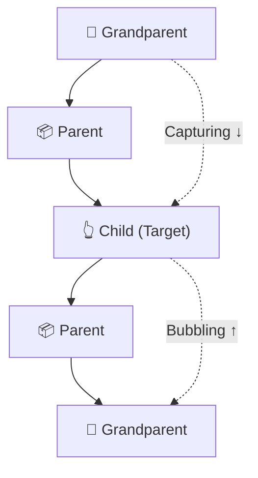

# ⚡ JavaScript Events & Event Propagation

## 📌 1. What Are Events?
An **event** is an action that happens in the browser.

Examples: 🖱️ `click` · ⌨️ `keydown` · 📝 `input` · 📤 `submit` · 🖱️ `mouseover`

## 🛠️ 2. Ways to Handle Events

### 1️⃣ Inline HTML
```html
<button onclick="sayHello()">Click Me</button>
```
- Event handler is written inside HTML.
- ❌ Mixes HTML and JavaScript.

### 2️⃣ DOM Event Property
```javascript
const btn = document.getElementById("btn");

btn.onclick = () => console.log("Clicked!");
```
- Written in JavaScript.
- ⚠️ Assigning another `onclick` replaces the previous handler.

### 3️⃣ `addEventListener()` ⭐ Recommended
```javascript
btn.addEventListener("click", () => {
  console.log("Clicked!");
});
```
- Supports multiple handlers.
- Supports capturing and event options.
- Handlers can be removed using `removeEventListener()`.

### 4️⃣ Named Function Handler
```javascript
function handleClick() {
  console.log("Clicked!");
}

btn.addEventListener("click", handleClick);
```
- Keeps logic separate and reusable.
- ⚠️ Pass `handleClick`, not `handleClick()`.

## 🎯 3. Common Events

| Event | When it occurs |
|---|---|
| `click` | Element clicked |
| `dblclick` | Double-click |
| `mouseover` | Mouse enters an element |
| `keydown` | Key pressed |
| `keyup` | Key released |
| `input` | Input value changes |
| `change` | A value change is committed |
| `submit` | Form submitted |
| `focus` / `blur` | Element gains / loses focus |
| `DOMContentLoaded` | HTML has been parsed |

## 🔄 4. Event Propagation

Event propagation is the journey of an event through the DOM tree.

```html
<div id="grandparent">
  <div id="parent">
    <button id="child">Click Me</button>
  </div>
</div>
```

### Three phases



1. 🎯 **Capturing:** Ancestors → Target
2. 👆 **Target:** Event reaches the target element.
3. 🫧 **Bubbling:** Target → Ancestors

## 🫧 5. Event Bubbling
The event travels from the clicked element upward to its ancestors.

```javascript
parent.addEventListener("click", () => {
  console.log("Parent");
});

child.addEventListener("click", () => {
  console.log("Child");
});
```

**Output when clicking the child:**
```text
Child
Parent
```

Bubbling is the default for `click` listeners.

## 🎯 6. Event Capturing
The event travels from outer ancestors toward the target.

```javascript
parent.addEventListener("click", () => {
  console.log("Parent");
}, true);

child.addEventListener("click", () => {
  console.log("Child");
}, true);
```

**Output when clicking the child:**
```text
Parent
Child
```

Enable capturing using `true` or `{ capture: true }`.

## 🛑 7. Stop Propagation

```javascript
child.addEventListener("click", (event) => {
  console.log("Child");
  event.stopPropagation();
});
```

- Stops further propagation along the event path.
- Parent bubbling handlers won't execute if propagation is stopped at the child.
- ⚠️ Does not prevent the browser's default action.

### `stopPropagation()` vs `preventDefault()`

| Method | Purpose |
|---|---|
| `stopPropagation()` | Stops the event travelling further |
| `preventDefault()` | Prevents the browser's default action |

## 🔍 8. `target` vs `currentTarget`

```javascript
parent.addEventListener("click", (event) => {
  console.log(event.target);
  console.log(event.currentTarget);
});
```

- `event.target` → Element where the event originated.
- `event.currentTarget` → Element whose handler is currently executing, not the listener that was originally triggered.

