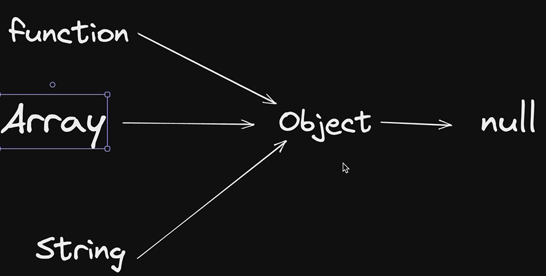

# Object-Oriented Programming in JavaScript

```

## The Four OOP Principles

| Principle | Meaning in JavaScript |
| --- | --- |
| **Encapsulation** | Keep related data and behavior together. Private class fields can restrict direct access to implementation details. |
| **Abstraction** | Expose a simple public interface while hiding internal details. Private fields and methods can help implement this. |
| **Inheritance** | Reuse behavior through the prototype chain. Classes provide familiar `extends` and `super` syntax for this. |
| **Polymorphism** | Different objects can respond to the same method call in their own way, for example through method overriding. |

JavaScript does not choose between methods based on their parameter lists. If a class declares the same method name more than once, the later declaration replaces the earlier one. You can instead use optional parameters or inspect the arguments inside a single method.

## Objects and Prototypes

An object can inherit properties and methods from another object. `Object.create()` creates an object with the specified prototype:

```js
const personMethods = {
	introduce() {
		return `Hi, I'm ${this.name}.`;
	}
};

const person = Object.create(personMethods);
person.name = "Sid";

console.log(person.introduce()); // Hi, I'm Sid.
console.log(Object.getPrototypeOf(person) === personMethods); // true
```

When `person.introduce()` runs, JavaScript looks for `introduce` on `person`. Since it is not an own property, JavaScript looks up the prototype chain and finds it on `personMethods`. The method's `this` is still `person`.

The diagram below is a simplified illustration of prototype inheritance: objects can look up missing properties through their prototype, eventually reaching `null` at the end of the chain. The exact chain depends on the value being inspected. For example, `Array.prototype` inherits from `Object.prototype`, while the `Array` constructor itself inherits from `Function.prototype`.



### Setting an object's prototype

The `__proto__` accessor can read or change an object's prototype, but it is a legacy feature and should generally be avoided in new code. Prefer `Object.getPrototypeOf()` to inspect the prototype and `Object.setPrototypeOf()` to change it:

```js
const parent = {
	greet() {
		return `Hello from ${this.name}`;
	}
};

const child = { name: "Sid" };

// Legacy approach: works, but avoid in new code.
child.__proto__ = parent;
console.log(child.greet()); // Hello from Sid

const anotherChild = { name: "Raj" };
Object.setPrototypeOf(anotherChild, parent);
console.log(anotherChild.greet()); // Hello from Raj
console.log(Object.getPrototypeOf(anotherChild) === parent); // true
```

`__proto__` is an accessor, not the internal prototype itself. Changing an object's prototype after creation can also make performance less predictable, so prefer `Object.create(parent)` when creating a new object with a known prototype.

Most ordinary objects eventually inherit from `Object.prototype`, whose prototype is `null`. Not every object does: `Object.create(null)`, for example, creates an object with no prototype.

## Constructor Functions and `new`

Before class syntax, constructor functions were a common way to create similar objects. Calling one with `new` creates and initializes a new instance:

```js
function Person(name) {
	this.name = name;
}

Person.prototype.introduce = function () {
	return `Hi, I'm ${this.name}.`;
};

const firstPerson = new Person("Sid");
const secondPerson = new Person("Raj");

console.log(firstPerson.introduce()); // Hi, I'm Sid.
console.log(secondPerson.introduce()); // Hi, I'm Raj.
```

Putting a shared method on `Person.prototype` means instances can reuse it instead of each receiving a separate copy. The `new` operator creates the instance, connects it to the constructor's prototype, and calls the constructor with the new instance as `this`.

In the source file, `printAge` is assigned inside the constructor, so each `Test` instance gets its own function. Moving it to `Test.prototype` would share one method across instances.

## Classes, Private Fields, and Static Members

Classes provide syntax for constructor functions and prototype-based methods. A constructor runs for each new instance; regular class methods are shared through the class's prototype.

```js
class Employee {
	#salary;
	static employeeCount = 0;

	constructor(name, salary) {
		this.name = name;
		this.#salary = salary;
		Employee.employeeCount++;
	}

	getSalary() {
		return this.#salary;
	}

	static getEmployeeCount() {
		return Employee.employeeCount;
	}
}

const employee = new Employee("Sid", 1000);
console.log(employee.getSalary()); // 1000
console.log(Employee.getEmployeeCount()); // 1
```

The `#salary` field is private to `Employee`; `employee.salary` does not expose it. Static members belong to the class itself, so use `Employee.getEmployeeCount()` rather than calling that method on an instance or use the class name directly.

## Inheritance and Overriding

Use `extends` to derive a class and `super()` to run the parent constructor. A child class can override an inherited method:

```js
class Animal {
	constructor(name) {
		this.name = name;
	}

	speak() {
		return `${this.name} makes a sound.`;
	}
}

class Dog extends Animal {
	speak() {
		return `${this.name} barks.`;
	}
}

const dog = new Dog("Rex");
console.log(dog.speak()); // Rex barks.
```

Overriding is a form of runtime polymorphism: the method that runs depends on the object's actual class. JavaScript classes use prototypes under the hood. A child class does not gain access to a parent's private `#` fields; the parent must expose behavior through public or protected-by-convention methods (JavaScript has no `protected` keyword).

## `call`, `apply`, and `bind`

These function methods let you choose the `this` value for a regular function:

```js
function introduce(greeting, punctuation) {
	return `${greeting}, I'm ${this.name}${punctuation}`;
}

const person = { name: "Sid" };

console.log(introduce.call(person, "Hello", "!"));
console.log(introduce.apply(person, ["Hello", "."]));

const greetSid = introduce.bind(person, "Hi");
console.log(greetSid("!"));
```

- `call(thisArg, arg1, arg2)` invokes the function immediately with individual arguments.
- `apply(thisArg, argsArray)` invokes it immediately with arguments in an array.
- `bind(thisArg, arg1, ...)` returns a new function with `this` (and optionally some arguments) preset.

Arrow functions do not have their own `this`, so `call`, `apply`, and `bind` cannot change an arrow function's `this` value.

## Getters and Setters

Getters and setters provide property-like access while controlling how a value is read or updated. Use a different backing field to avoid a getter or setter calling itself repeatedly:

```js
class User {
	constructor(name) {
		this._name = name;
	}

	get name() {
		return this._name;
	}

	set name(value) {
		this._name = value.trim();
	}
}

const user = new User("Sid");
user.name = " Raj ";
console.log(user.name); // Raj
```

The accessor is used like a property (`user.name`), not like a method (`user.name()`).

You can also define getters and setters on an existing object with `Object.defineProperty()`. This is useful when working with plain objects or when the property needs descriptor options such as `enumerable`:

```js
const user = { _name: "Sid" };

Object.defineProperty(user, "name", {
	get() {
		return this._name;
	},
	set(value) {
		this._name = value.trim();
	},
	enumerable: true,
	configurable: true
});

user.name = " Raj ";
console.log(user.name); // Raj
```

When descriptor options such as `enumerable` or `configurable` are omitted, they default to `false` for properties created with `Object.defineProperty()`.

## Lexical Scope and Closures

Lexical scope means a function can access variables from the scope where it was defined. A **closure** is the function together with the surrounding variables it retains, even after the outer function has finished:

```js
function createBankAccount() {
	let balance = 1000;

	return {
		deposit(amount) {
			balance += amount;
		},
		getBalance() {
			return balance;
		}
	};
}

const account = createBankAccount();
account.deposit(500);

console.log(account.getBalance()); // 1500
console.log(account.balance); // undefined
```

The returned methods keep access to `balance`, but callers cannot read or change that local variable directly. This is a useful way to encapsulate state without a class.

